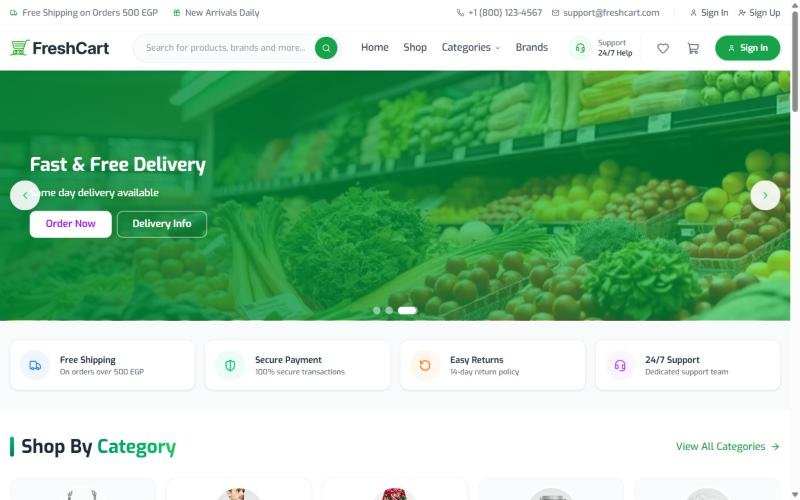
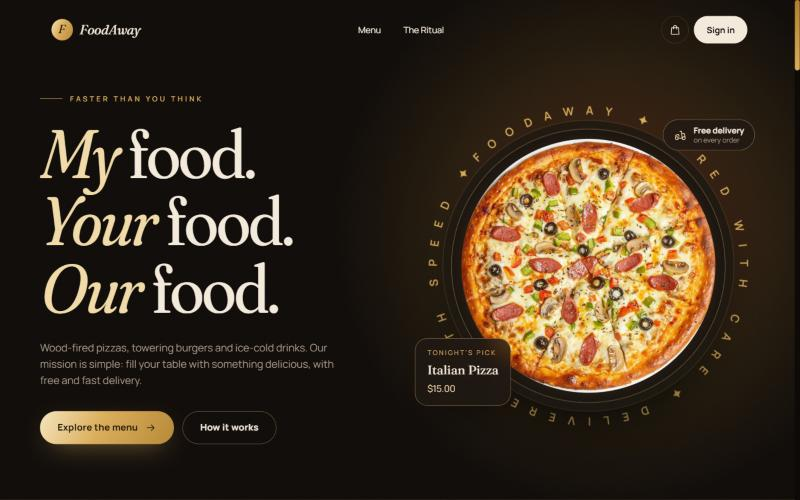
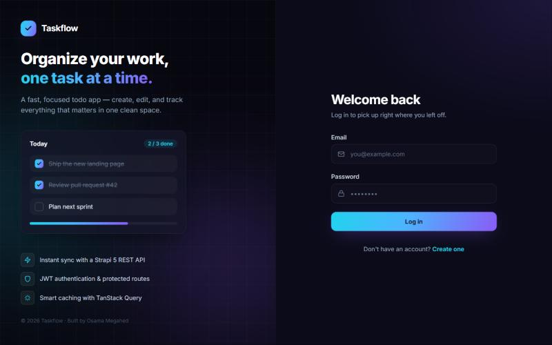
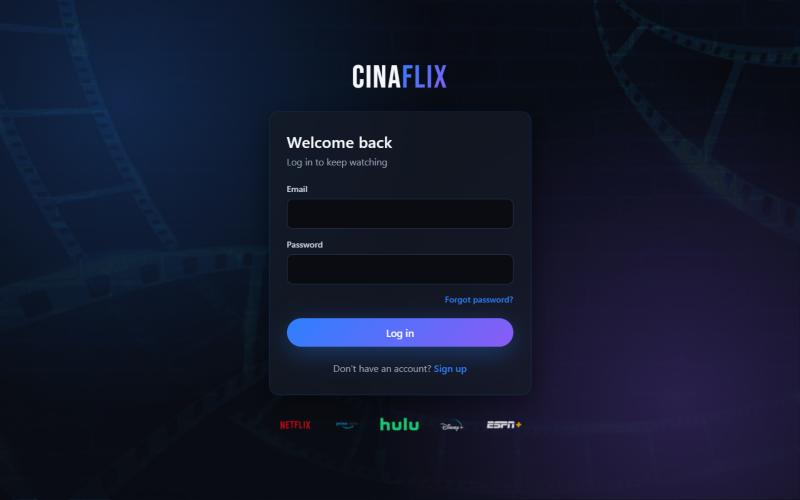

# Osama Megahed

**Front-End Developer** building with React, Next.js and TypeScript. Alexandria, Egypt.

I'm an Electronics & Communications Engineer (AAST) who moved into front-end development, and I took a smart-shoe startup from idea to funding along the way. I care about products that work end to end, from the circuit board to the browser.

**Open to** front-end internships and junior roles.

[Portfolio](https://portfolio-nine-phi-nw8cnmt42u.vercel.app) · [LinkedIn](https://www.linkedin.com/in/osama-megahed-887b76201/) · [Email](mailto:osamamegahed2468@gmail.com)

## Featured projects

<table>
  <tr>
    <td width="320"></td>
    <td>
      <strong>FreshCart</strong> 
      Grocery e-commerce storefront, in active development.  
      Next.js 16 · React 19 · TypeScript · Tailwind CSS 4  
      <a href="https://fresh-cart-tau-liard.vercel.app">Live</a> · <a href="https://github.com/osama24680/FreshCart">Code</a>
    </td>
  </tr>
  <tr>
    <td width="320"></td>
    <td>
      <strong>FoodAway</strong> 
      Food ordering with online payment and a CMS-driven menu.  
      Next.js · Sanity · Stripe · Zustand  
      <a href="https://food-away.vercel.app">Live</a> · <a href="https://github.com/osama24680/Food-Orders">Code</a>
    </td>
  </tr>
  <tr>
    <td width="320"></td>
    <td>
      <strong>Taskflow</strong> 
      Full-stack task manager with JWT auth and server-side pagination.  
      React · TypeScript · TanStack Query · Strapi 5  
      <a href="https://to-do-full-app.vercel.app">Live</a> · <a href="https://github.com/osama24680/ToDo-Full-App">Code</a>
    </td>
  </tr>
  <tr>
    <td width="320"></td>
    <td>
      <strong>CinaFlix</strong> 
      Movie and TV discovery app using 12 TMDB endpoints.  
      React · React Router · Axios  
      <a href="https://cinaflix.pages.dev">Live</a> · <a href="https://github.com/osama24680/Movie-App">Code</a>
    </td>
  </tr>
</table>

## Vectos (formerly ShoesFit)

AI smart shoes that flag health risks early, combining embedded systems, IoT, AI and a web platform. It started as my graduation project.

- $1,000 in funding
- Top 10 in Plan International's entrepreneurship program
- 7th place at AAST Rally 2024

[Web platform code](https://github.com/osama24680/Vectos)

## Tech

  &nbsp;&nbsp;
  &nbsp;&nbsp;
  &nbsp;&nbsp;
  &nbsp;&nbsp;
  &nbsp;&nbsp;
  &nbsp;&nbsp;
  

**Also worked with:** TanStack Query, Zustand, REST APIs, GraphQL, Sanity, Strapi, Firebase, Figma
